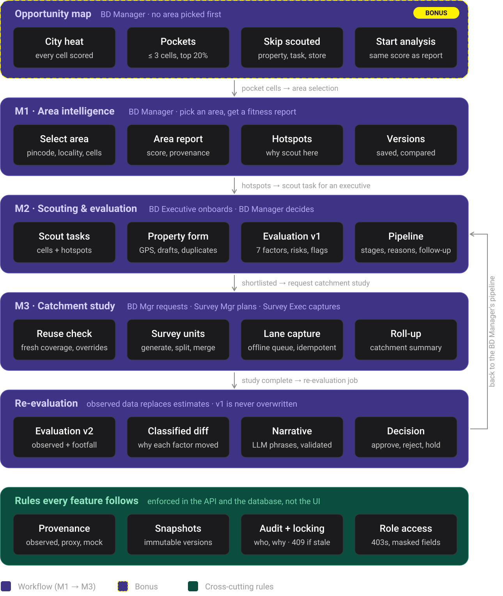
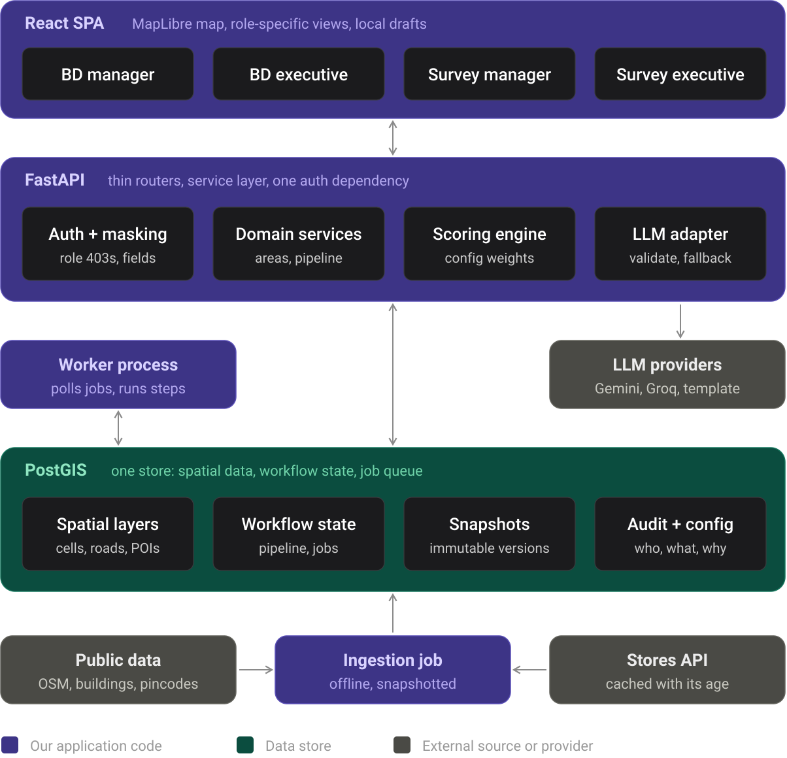

# Savo SiteScout

**Expansion intelligence for Savomart** (neighbourhood grocery, Chennai): pick an area, get an
explainable fitness report, scout properties, evaluate them, commission a catchment survey, and
roll the survey back into a re-evaluation that explains exactly why the score moved.

Built solo for the Savomart full-stack hackathon, 28–30 Sep 2026. The git history is the timeline.

**▶ Video demo:** _[link to be added]_ <!-- TODO: replace with the video URL -->

| | |
|---|---|
| Run it | [Setup](#1-setup-run-it-locally-end-to-end) · [Demo users](#2-demo-credentials) |
| Understand it | [Features](#3-what-it-does) · [Architecture](#4-architecture) · [Data model](#5-data-model) · [Data sources](#6-data-sources-and-processing) · [Scoring and AI](#7-how-scoring-and-ai-work) |
| Judge it | [Tech choices](#8-tech-and-library-choices) · [Decisions and trade-offs](#9-design-decisions-and-trade-offs) · [Known issues](#10-known-issues-and-what-id-improve) · [AI tool use](#11-how-ai-tools-were-used) |

Deeper design notes live in [`docs/`](docs/): [`DESIGN.md`](docs/DESIGN.md) (full design),
[`DECISIONS.md`](docs/DECISIONS.md) (every decision in order, with the reasoning and measurements),
[`PHASES.md`](docs/PHASES.md) (build plan and checkpoints), [`DATA.md`](docs/DATA.md) and
[`data/MANIFEST.md`](data/MANIFEST.md) (data sources, citations).

---

## 1. Setup: run it locally end to end

**Prerequisites:** Docker Desktop (Compose v2), `make`, `curl`, ~3 GB free disk. Tested on macOS
(Apple Silicon); the PostGIS image is multi-arch.

### 1.1 One command

```bash
git clone <this repo> && cd savomart-fullstack-hackathon-2026-22pd33
make setup
```

`make setup` ([`scripts/setup.sh`](scripts/setup.sh)) is idempotent (safe to re-run) and does, in order:

1. **`.env`**: created from [`.env.example`](.env.example) with a random `APP_SECRET` if it doesn't
   exist. Add `SAVO_STORES_TOKEN` (needed once, to download the store list) before the first run.
   LLM keys are **optional**: without them every narrative uses the deterministic template.
2. **Raw data** (`make fetch-data`, [`scripts/fetch_data.sh`](scripts/fetch_data.sh)): downloads every
   dataset into `data/raw/` (git-ignored, ~630 MB) and **checks each file's sha256** against the exact
   files the snapshot was built and validated on. Verified files are skipped; a mismatch is an error.
3. **Database + schema**: starts PostGIS and runs the migrations (schema, triggers, the 4 demo users,
   config registry).
4. **Services**: api, worker and web, waiting until `/health` is ok.
5. **Data snapshot**: `make ingest` builds snapshot #1 (~90 s), skipped if one already exists.

Measured from a fresh clone with the data already downloaded: **1 m 48 s** to a running app; a re-run
takes ~16 s. The first download adds ~3–10 min depending on the network.

- **Web:** http://localhost:5173 (choose a user on the landing page)
- **API:** http://localhost:8000, interactive docs at http://localhost:8000/docs
- `make reload-env` after editing `.env` (containers read it only when created).

### 1.2 Where the raw data comes from

Analysis never calls an external API at run time (§9); `make fetch-data` downloads these once:

| Path under `data/raw/` | Source | Notes |
|---|---|---|
| `osm/southern-zone-260927.osm.pbf` | [Geofabrik India › Southern Zone](https://download.geofabrik.de/asia/india/southern-zone.html), dated extract | ~558 MB |
| `buildings_ms/india_1233122{01,03,10,12}.csv.gz` | [Microsoft Global ML Building Footprints](https://github.com/microsoft/GlobalMLBuildingFootprints), release 2026-02-03 | 4 quadkey tiles, ~70 MB |
| `wards/wards_2022.kml`, `wards/zones_2022.kml` | [OpenCity — GCC Ward Information](https://data.opencity.in/dataset/gcc-ward-information) | 200 wards, 15 zones |
| `pincode/chennai_boundary_datameet.geojson` | [datameet/PincodeBoundary](https://github.com/datameet/PincodeBoundary) `Chennai/boundary.geojson` | 68 polygons |
| `pincode/pincode_directory_bharatpin.csv` | `bharatpin/data/pincodes.csv` inside the [`bharatpin` 1.0.1](https://pypi.org/project/bharatpin/) wheel | India Post directory |
| `stores/stores_YYYYMMDD.json` | Savomart Stores API, `GET` with `X-cron-token` (the brief's example forces `POST`, which returns 405) | Needs `SAVO_STORES_TOKEN`; the newest file wins |

Full provenance (licences, retrieval dates, row counts): [`data/MANIFEST.md`](data/MANIFEST.md).

### 1.3 Step by step (what `make setup` runs)

```bash
make fetch-data                              # verified downloads
docker compose up -d --build --wait db       # PostGIS
docker compose run --rm api alembic upgrade head
make up                                      # api + worker + web
make ingest                                  # new data snapshot (~90 s)
make health                                  # {"status":"ok", ...}
```

### 1.4 Walk the loop

A fresh database has data but no workflow history yet. The shortest end-to-end path:

1. **Meera (BD Manager)** → *Opportunities* → **Run analysis** on a pocket, or *Analyse area* →
   pincode `600017` → **Run analysis**. On the report, create a **scout task** from the hotspots
   for Karthik.
2. **Karthik (BD Executive)** → the task → **Add property** (GPS or tap the map; rent, area, frontage…).
   It saves first, then evaluates (v1).
3. **Meera** → *Pipeline* → the property → move it *Under review* → *Shortlisted* → **Request study**.
   *(Optional, to demo reuse: `make seed-captures PROPERTY=<id>` seeds labelled mock past captures
   around it first.)*
4. **Divya (Survey Manager)** → the study → decide reuse → **Plan** (units are generated) →
   edit if needed → **assign** units to Arjun.
5. **Arjun (Survey Executive)** → *My units* → capture each lane (works offline; queued sends) →
   **Submit unit**.
6. The last submission rolls the study up into a **Catchment Summary**, which triggers
   **evaluation v2**. **Meera** sees *What changed: v1 → v2* on the property.

### 1.5 Tests

```bash
make test      # 226 tests, ~40 s, inside the api container. Never call a real LLM API.
```

Run one `make test` at a time: runs share the test database and job queue. On a fresh install one
test is skipped by design (cross-snapshot matching needs a second data snapshot).

---

## 2. Demo credentials

There are no passwords: the landing page and the header's **role switcher** sign in as one of four
seeded users (a real HMAC-signed bearer token per user). Access rules are enforced **server-side**
(role checks → 403, per-role response builders strip fields), never by hiding buttons.

| id | User | Role | Lands on | In short (details in [§3.1](#31-features-by-persona)) |
|---|---|---|---|---|
| 1 | **Meera** | BD Manager | Home → Analyse / Opportunities / Reports / Pipeline | Run and compare area reports, opportunity map, create scout tasks, see all properties, **the only role that moves pipeline stages**, request studies |
| 2 | **Karthik** | BD Executive | My tasks | See tasked hotspots, onboard properties, see own properties, answer follow-ups |
| 3 | **Divya** | Survey Manager | Studies inbox | Plan studies (final reuse say), edit/assign units, close early. Sees properties **without** rent/deposit/owner fields |
| 4 | **Arjun** | Survey Executive | My units | Capture lanes on assigned units only; sees the property as a label, nothing more |

API: `POST /auth/demo-login {"user_id": 1..4}` → `{"token": ...}`; send `Authorization: Bearer <token>`.
`DEMO_AUTH=false` disables the demo login.

---

## 3. What it does



### 3.1 Features by persona

**Meera — BD Manager** (decides where to open)
- **Analyse an area**: pick by pincode, locality search or cells on the map; preview the boundary,
  add/remove cells, see earlier reports of the same area, then run.
- **Area Fitness Report**: score, rating and confidence; every factor as raw → normalised → weight →
  contribution with its provenance; hotspots with "why scout here"; facts, caveats, a validated
  narrative (and who wrote it); "data as of" stamps; run again as a new version.
- **Reports and compare**: every run kept by area; tick two to compare side by side (flags different
  data or config versions).
- **Opportunity map** (bonus): the best un-scouted pockets across Chennai; run an analysis on one in
  a click, or adjust its cells first.
- **Scout tasks**: turn a report's hotspots into a task for a BD Executive.
- **Pipeline board**: every property by stage, best-rated first.
- **Property review**: a 30-second card (rating, top risks, rent vs band, completeness,
  duplicates), next step, full breakdown with version picker, re-evaluate, map, photos, notes, history.
- **Stage moves and follow-ups**: move stages with a reason (a stale edit is caught and re-confirmed);
  ask the executive for more (photos, revisit, rent check).
- **Request a catchment study**: see fresh-data coverage first; waive or force reuse with a reason.
- **What changed v1 → v2**: the re-evaluation after a study, every factor change classified,
  with a narrative.

**Karthik — BD Executive** (finds and onboards sites)
- **My tasks**: assigned tasks, open follow-ups and unsent drafts on one screen.
- **Task map**: the task's cells with numbered hotspots and a route into the property form.
- **Add property** (phone-first): GPS or tap-to-pin with a live location check (inside Chennai, not in
  water, GPS accuracy), locality prefilled, rent-band hint, frontage, visibility, owner contact.
  Autosaves a draft; the submit is idempotent, so a retry never creates a duplicate.
- **Duplicate check**: a nearby similar property is shown with two explicit choices, same or different.
- **Photos and notes**; **follow-up answers** that send the property back for review.
- **My properties**: each with its evaluation card (rating, risks, what's missing).

**Divya — Survey Manager** (plans the field work)
- **Studies inbox**: requested and running studies. Property details arrive **without** rent,
  deposit or owner fields.
- **Reuse decision**: the catchment's lanes coloured fresh / stale / uncovered, length-weighted
  coverage, and the final say on the mode (reuse and fill, reuse only, full survey), with a reason.
- **Survey units**: generated as contiguous walks balanced by time; select lanes on the map to move,
  split or merge (the one-lane-one-unit rule is re-checked after every edit); assign to executives.
- **Progress and close**: lanes surveyed / gaps per unit; close a study early or re-run the roll-up
  (with a reason); the Catchment Summary card.

**Arjun — Survey Executive** (walks the lanes)
- **My units**: only the units assigned to him; the property is a label, nothing more.
- **Unit map**: lanes numbered in walking order, coloured by status.
- **Lane capture** (phone-first): a timer for the pedestrian count, steppers for homes / businesses /
  grocery stores, anchors, road width, access and parking ratings, GPS or tap, or "could not survey"
  with a reason. Autosaves; works offline with a send queue; sends are idempotent.
- **Submit unit** when every lane is handled.

### 3.2 Feature list

| Feature | Module | Who | Short description |
|---|---|---|---|
| Area selection (3 modes) | M1 | BD Mgr | Pincode, locality or map cells, all resolved to the same H3 cells; size caps; edits; ambiguity never guessed |
| Area Fitness Report | M1 | BD Mgr | Explainable 5-factor score with provenance, confidence, facts-only or insufficient-data when data is thin |
| Hotspots | M1 | BD Mgr | Top fine cells, spread out, each with its two strongest reasons |
| Report versions + compare | M1 | BD Mgr | Immutable reports per area; side-by-side diff that flags data/config differences |
| Opportunity map | Bonus | BD Mgr | Citywide un-scouted pockets; start an analysis that reproduces the pocket score |
| Scout tasks | M2 | BD Mgr → BD Exec | Cells + hotspots handed to an executive; status follows the work |
| Property form | M2 | BD Exec | Save-first capture with GPS, validation, drafts, idempotent submit, photos |
| Duplicate detection | M2 | BD Exec | ≤ 25 m + name similarity; explicit same/different resolution |
| Property evaluation (v1) | M2 | system | 7 site factors, completeness gate (Needs Info), hard flags, rule-based risks |
| Review card | M2 | BD Mgr | Decision-ready summary in ~30 seconds; full breakdown below |
| Pipeline + audit | M2 | BD Mgr | Stage moves with reasons, optimistic locking, reject → reopen, full history |
| Follow-up loop | M2 | BD Mgr ↔ BD Exec | Manager asks, executive answers, property returns to review |
| Study request + reuse check | M3 | BD Mgr, Survey Mgr | Per-lane freshness (90 days), length-weighted coverage, audited overrides |
| Survey units | M3 | Survey Mgr | Generated contiguous walks; move / split / merge / assign; invariant enforced |
| Lane capture | M3 | Survey Exec | Raw observations per lane, offline queue, idempotent, GPS distance and time checks |
| Roll-up → Catchment Summary | M3 | system | Surveyed lanes only, time-band mix, observed vs OSM competition, confidence; immutable |
| Re-evaluation v2 + diff | M3 | system → BD Mgr | Observed signals replace estimates; every change classified; points add up |
| Validated narratives | All | system | LLM phrases code-built facts; validator; Gemini → Groq → template |
| Jobs with progress + retry | All | all | Step-by-step progress, named failed step, resume from it |
| Role access + field masking | All | all | Server-side 403s and per-role responses |

---

## 4. Architecture



- **React SPA** (Vite): one app, four role-specific homes. MapLibre renders the map; the only
  third-party fetch in the browser is the OpenFreeMap base map. Field drafts live in `localStorage`.
- **FastAPI**: thin routers (`backend/app/api/`) → a service layer holding every business rule
  (`backend/app/services/`) → SQLAlchemy/GeoAlchemy2. One auth dependency (`require_roles`) and
  per-role response builders (`backend/app/schemas/`).
- **Worker**: the same codebase, polling a `jobs` table (`SELECT … FOR UPDATE SKIP LOCKED`), with a
  heartbeat, a reaper that re-queues jobs whose worker died, and **per-step persistence** so a retry
  resumes at the failed step. Jobs: `area_report`, `property_evaluation`, `study_rollup`.
- **PostGIS**: one store for spatial data, workflow state, the job queue, snapshots, audit, config
  registry and the LLM call log/cache.
- **Ingestion** (`backend/ingest/`, `make ingest`): offline CLI that builds a new, versioned **data
  snapshot**. Never imported by the API or worker.
- **LLM adapter** (`backend/app/llm/`): Gemini → Groq → deterministic template, with a validator
  on every answer (§7).

---

## 5. Data model

PostgreSQL 17 + PostGIS 3.5, 14 Alembic migrations (`backend/alembic/versions/`). Geometry is
EPSG:4326. Grouped by purpose:

| Group | Tables | What they hold |
|---|---|---|
| **Reference snapshot** (rebuilt by each ingest, keyed by `snapshot_id`) | `data_snapshots`, `data_sources`, `zones`, `wards`, `service_area`, `post_offices`, `pincodes`, `stores`, `localities`, `h3_cells` | A dated, checksummed copy of every external dataset. `data_sources` records each file's sha256, size, retrieval time and row count. `h3_cells`: res-9 score cells and their res-8 parents |
| **OSM + features** | `osm_pois`, `osm_buildings`, `osm_landuse`, `ml_buildings`, `road_segments`, `cell_features` | Clipped OSM; roads split at junctions into **segments** (the survey atom); `cell_features` = per-cell counts/lengths/footprint + the `scoreable` mask |
| **M1** | `area_reports` | Immutable, versioned per `area_key`: selection, resolved cells, result, hotspots, facts, narrative + its source, snapshot and config version |
| **M2** | `scout_tasks`, `properties`, `property_notes`, `property_photos`, `follow_ups`, `property_evaluations` | `properties` is mutable with a `version` (optimistic locking) and a `stage`; `property_evaluations` are immutable versions (v1, v2…) with factors, risks, hard flags, and for v2 the `study_id`, `summary_id`, `diff` and narrative |
| **M3** | `studies`, `study_segments`, `survey_units`, `segment_captures`, `catchment_summaries` | A study's catchment segments with their reuse state and unit; `segment_captures` is **append-only** (the latest counts, idempotent by client id); `catchment_summaries` are immutable versions |
| **Platform** | `users`, `audit_events`, `config_versions`, `jobs`, `job_steps`, `llm_calls` | Append-only audit (who, what, from → to, **reason**, when); every config version's content hash; job/step state; every LLM call (provider, model, latency, validation errors) doubling as the cache |

**Invariants enforced by the database**, not just the code: immutable tables reject `UPDATE`/`DELETE`
via triggers (`area_reports`, `property_evaluations`, `catchment_summaries`, `segment_captures`,
`audit_events`); one open study per property (partial unique index); a unit's segments belong to
exactly one unit (foreign key + re-validation after every edit); a config version with changed
content is refused at startup.

---

## 6. Data sources and processing

| Data | Used for | Processing |
|---|---|---|
| **OpenStreetMap** (Geofabrik, 2026-09-27) | Roads, POIs (competitors, transit, schools, hospitals, markets, offices), land use | Clipped with `osmium` to the metro box; read with `pyosmium`; roads **split at junctions** into ~301k segments with stable ids; POIs classified by config rules; sea derived from the coastline |
| **Microsoft ML building footprints** (2026-02) | Demand proxy (footprint m² per cell) | 4 quadkey tiles, ~808k buildings in the box. Added at the Phase 2 data gate: OSM buildings are unmapped in whole zones (Manali, Tondiarpet…) |
| **GCC wards (200) and zones (15), 2022** | Service area, labels | Geometry cleaned (`ST_MakeValid`); service area = union of wards with digitising slivers filled |
| **Pincode polygons** (datameet, ~2013) + **pincode directory** (`bharatpin`) | Pincode selection, locality search | Polygons cover only the old core (67 of 120 pincodes), so missing pincodes get **Voronoi extents** from post-office points, clipped to GCC; every geometry records which it is, and the UI labels it |
| **Savomart Stores API** | Cannibalisation, map | Fetched once to a dated JSON file; all zones kept. If the cache is older than 30 days, cannibalisation is **excluded** and says why |

**Processing pipeline** (`make ingest`, ~90 s, one transaction per step, a failed step marks the
snapshot failed): zones → wards → service area → post offices → pincodes → stores → **H3 grid**
(res 9 ≈ 0.1 km² for scoring, res 8 ≈ 0.7 km² for selection) → OSM → ML buildings → **cell
features** (counts, road lengths, footprint, land-use shares, a `scoreable` mask for sea, water,
airport, industrial and empty land) → **locality index** (post offices, OSM places, wards; fuzzy
trigram search, never a live geocoder).

**Not used:** Census 2011 (only 155 pre-2011 wards; joining to today's 200 is untested, and ML
footprints cover the whole city), data.gov.in pincode boundaries (download failed), Nominatim,
OSRM (radius catchments instead), Bhuvan (the OSM mask passed the Phase 2 gate).
**Mock data**, always labelled: illustrative rent bands per zone group, and optional demo past
survey captures (`source = demo_seed`).

---

## 7. How scoring and AI work

### Core rules (apply to every score)

1. **Provenance on every value:** observed, observed lower bound, proxy, mock, mixed, missing.
2. **Missing is never zero.** A factor without data is excluded and the weights renormalise. If more
   than 40% of the weight is missing, the result is **facts only**: no rating.
3. **Deterministic and explainable:** every factor shows raw → normalised → weight → contribution.
   All weights, thresholds, radii and caps live in [`config/sitescout.yaml`](config/sitescout.yaml),
   and every output records the config version and data snapshot it used.

### M1 area score

Five factors per res-9 cell, each a **percentile across all scoreable cells in Chennai** (so a score
means "compared with the rest of the city"): demand 30 (ML footprint), footfall anchors 20
(weighted transit/markets/schools/hospitals/offices within ~350 m), competition 20 (OSM grocery
within ~650 m, **a lower bound**, fewer is better), distance from Savomart 15, accessibility 15
(road metres, main roads double). Area score = weighted mean over the area's scoreable cells.
Ratings: ≥ 70 Strong fit, ≥ 50 Moderate, else Weak. Confidence comes from the provenance mix.
Too little scoreable land (e.g. mostly sea) → **insufficient data**, never a fabricated score.

### M2 property evaluation

Seven site-level factors (≈ 600 m around the pin): site demand 25, competition 15,
cannibalisation 15, rent affordability 15 (rent/sq ft within the illustrative band), accessibility
10, visibility/frontage 10, area opportunity 10 (the M1 score, as a low-weight prior). **Completeness
is a gate, not a weight:** missing rent or area → *Needs Info*. A Savomart store within 400 m is a
**hard flag** that caps the outcome one level. Risks are rules with an id, severity and evidence.
Outcomes: Strong Fit ≥ 70, Consider ≥ 50, Weak Fit, Needs Info.

### M3 roll-up and re-evaluation

Lane captures aggregate over **surveyed lanes only**: residential and commercial per 100 m, footfall
(timed count → hourly, length-weighted, with its time-band mix), accessibility, parking, observed
competition vs OSM's count, de-duplicated anchors. Below 50% coverage → facts only. Confidence steps
down for single time band, reuse-only, mostly reused or mostly demo data. Study scores use
**uncalibrated thresholds** (stated in config and UI; no citywide survey baseline exists yet).

On completion, **v2** replaces site demand, competition and accessibility with the observed values
and adds **footfall** (weight 15). The **diff** gives every changed factor a cause (*factor newly
included*, *data change*, *config change*, *renormalization*) and its point change; the point changes
add up to the score change, and the UI shows the sum. When a factor switches from a citywide
estimate to a study value, the diff says the scales differ ("not like-for-like").

### Opportunity map

Each res-8 cell is rated by the mean of its scoreable res-9 cell scores; pockets grow greedily from
the best cells above the citywide 80th percentile (≤ 3 cells), skipping scouted cells; each pocket
is then scored with the **same function as an area report**, so starting an analysis on it
reproduces the number exactly (tested).

### The AI: it phrases, it never calculates

```
code builds a fact sheet (JSON) → LLM writes prose → validator → accept
                                              │ reject (with reasons fed back)
                                              ▼
                          retry once → other provider → deterministic template
```

- **Grounding:** the model only sees a code-built fact sheet (scores, factors, facts, risks,
  causes). It returns JSON against a schema (summary + bullets).
- **Validator** (every answer, every provider): every number must trace to the fact sheet (rounding
  allowed; "down 8" traces to −8.0); the rating label must be the real one; for diffs, every named
  cause must be in the sheet; place/store names must come from the sheet (checked against every
  known locality and store name). **Caveats are written by code**, never by the model.
- **Resilience and cost:** a cache (same sheet + provider + model + prompt version → no call);
  retries with backoff and `Retry-After`; a circuit breaker per provider; client-side call spacing
  for free tiers; a 90 s total budget, then the template.
- **Transparency:** every report and evaluation records which source wrote its narrative (gemini,
  groq, template), the attempts and why any were rejected; the UI shows it and a "degraded" note
  when a fallback was used. Every call is logged in `llm_calls`.
- **Tests never call a real API** (an autouse fixture blocks it); the template passes the validator.

---

## 8. Tech and library choices

| Choice | Why |
|---|---|
| **FastAPI** + Pydantic | Typed request/response models make per-role masking explicit; auto OpenAPI docs; sync handlers keep the SQL straightforward |
| **PostgreSQL + PostGIS** | Spatial joins, distance and containment in SQL; triggers enforce immutability/append-only; one store also runs the job queue |
| **SQLAlchemy 2 + GeoAlchemy2 + Alembic** | Mature ORM with geometry types; versioned migrations |
| **H3** (`h3`, `h3-js`) | Equal-area hexagons: uniform neighbourhood rings for scoring, a clean two-level hierarchy (res 9 score / res 8 select) |
| **Postgres jobs table + worker** instead of Celery/Redis | One fewer service; transactional enqueue with the business change; `SKIP LOCKED` claiming; step-level resume. Throughput needs are tiny |
| **pyosmium + osmium-tool** | Streams a 558 MB extract in seconds after a clip; no Overpass rate limits; reproducible from a pinned, checksummed file |
| **React 19 + Vite + Tailwind v4** | Fast dev loop; utility CSS for a mobile-first field UI in the brand colours |
| **TanStack Query** | Caching, retries and background refetch; cached data stays visible offline |
| **React Router 7** | Role homes and deep links (report, property, study, unit, lane) |
| **MapLibre GL + OpenFreeMap** | Open-source WebGL maps, no API key, GeoJSON overlays with feature-state for cell selection |
| **Gemini (flash-lite) → Groq → template** | Free-tier friendly, fast; two providers plus a template means a narrative always exists |
| **Docker Compose** | One command brings up db, api, worker and web identically anywhere |

---

## 9. Design decisions and trade-offs

The full log with measurements is [`docs/DECISIONS.md`](docs/DECISIONS.md). The main ones:

- **Ingest offline, analyse from our own DB only.** Reproducible, fast, no rate limits, citable, at
  the cost of data freshness (a re-ingest creates a new snapshot; old reports keep pointing at theirs).
- **Immutable versions everywhere it matters** (area reports, evaluations, summaries): history
  and "why did this change" are always answerable. Cost: more rows and explicit v2 flows.
- **Road segments, not H3 cells, are the survey atom**: cells cut roads in half; people walk
  lanes. Units are contiguous walks over the road graph.
- **Unit generation, benchmarked:** plain balanced region growing fragmented units (up to 9
  disconnected pieces). Replaced by "stretch-first peeling" (1.3 pieces per unit on average), pinned
  by tests.
- **Completeness is a gate, not a weight**, so missing data is never penalised twice.
- **Percentile normalisation** makes M1 scores relative to Chennai (easy to explain, robust to
  skew), but not absolute. That's why study values (thresholds) and estimates (percentiles)
  aren't like-for-like, and the diff says so rather than hiding it.
- **Radius catchments, not isochrones** (no OSRM): simpler and honest ("approximate").
- **Demo auth** (role switcher + HMAC tokens) instead of real accounts: hackathon time goes to the
  workflow. Access control itself is real and tested as a full role × endpoint matrix.
- **Microsoft ML footprints over OSM buildings and census**: measured at the Phase 2 gate. OSM
  was near-empty in whole zones, and the census doesn't match today's wards.
- **The opportunity map is a live view, not a snapshot**: citywide scoring takes ~20 ms, and the
  immutable record is the area report started from a pocket.

---

## 10. Known issues and what I'd improve

**Known issues / limits**

- **No seeded demo workflow**: a fresh database has data but no reports, properties or studies until
  you walk the loop (§1.4). Next: a `make demo` seed that creates them through the API.
- **Study thresholds are uncalibrated** (config assumptions), so v1 → v2 point changes for switched
  factors are directional. Needs real surveys to calibrate.
- **OSM competition is a lower bound**: a demo survey found ~12× more shops than OSM in one
  catchment. The UI says so everywhere.
- **Area studies** (a study against an analysed area rather than one property) are designed but not
  built; studies are per property.
- **Capture photos** are not implemented (notes only); property photos are.
- **Offline**: drafts and a send queue, not a full offline-first sync; the base map needs a network.
- **Production build not packaged**: Compose runs the Vite dev server and `uvicorn --reload`. The
  MapLibre worker asset has not been checked in a production bundle yet.
- Pincode polygons are ~12 years old (Voronoi extents fill the gaps, labelled approximate).

**With more time:** calibrate study thresholds from accumulated surveys; isochrone catchments
(OSRM); census/income enrichment where it joins cleanly; a deploy with seeded demo data;
notifications for assignments and follow-ups; a shareable decision pack per property.

---

## 11. How AI tools were used

- **Claude Code** was my pair-programmer throughout, one phase at a time ([`docs/PHASES.md`](docs/PHASES.md)):
  turning the design into a phase plan, writing code and tests, running and debugging them,
  benchmarking undecided choices (pocket formation, unit partitioning, map layer timing), and
  drafting the docs, including this README. I set the design, reviewed every phase against its
  checkpoint, and pushed back where results were wrong. For example, unit fragmentation led to the
  partitioner rewrite, and a "competition improved" result that contradicted the survey led to the
  "not like-for-like" caveat. Corrections are logged in [`docs/DECISIONS.md`](docs/DECISIONS.md)
  (e.g. Flask → FastAPI, the Stores API's GET vs POST).
- **In the product**, Gemini (and Groq as fallback) only **phrase** code-built fact sheets for area
  reports and v1 → v2 diffs, behind the validator and template fallback in §7. No score, rating,
  risk or number comes from a model.
- API keys live only in the git-ignored `.env`; tests never call a real model.

---

## Repository map

```
config/sitescout.yaml   every weight, threshold, radius, cap (versioned; outputs record the version)
backend/app/            api/ (routers) · services/ (all business rules) · schemas/ (role masking)
                        models/ · jobs/ (queue, worker, steps) · llm/ (adapter, providers, validators)
backend/ingest/         offline snapshot builder (never used at request time)
backend/alembic/        migrations 0001–0014
backend/tests/          226 tests (scoring, access matrix, reuse, units, capture, roll-up, diff…)
frontend/src/features/  areas · opportunities · scouting · pipeline · studies · units
docs/                   BRIEF, DESIGN, DECISIONS, PHASES, DATA, images/
data/MANIFEST.md        citations for every dataset
```
